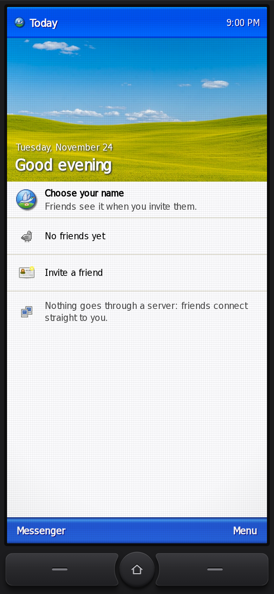
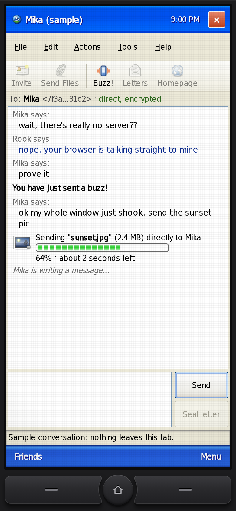
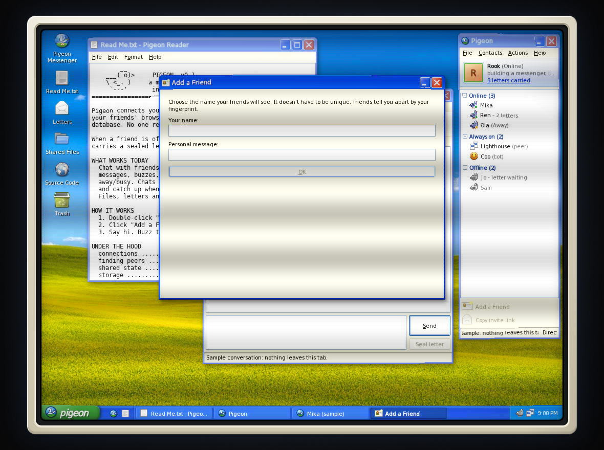
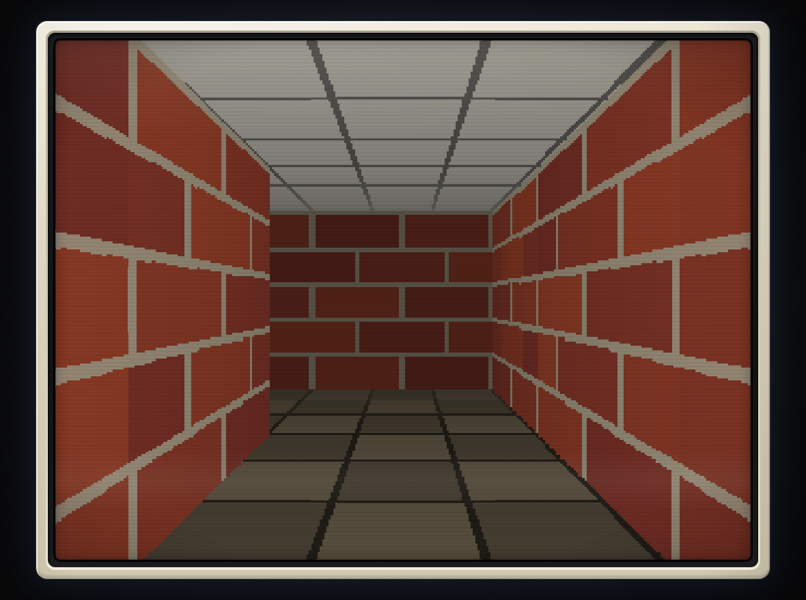

<div align="center">
    
    <h1>Pigeon</h1>
    <p>
        A messenger with nobody in the middle, inside an early-2000s desktop that never was.
    </p>
    <p>
        <a href="https://github.com/tomszir/pigeon/actions/workflows/ci.yml"></a>
        <a href="https://github.com/tomszir/pigeon/releases/latest"></a>
        <a href="LICENSE"></a>
    </p>
</div>

<p align="center">
    
</p>

> [!NOTE]
> Pigeon is in early development. Chatting with friends, on as many of your devices as you like, works today. Files, letters and pages hosted by friends aren't built yet.
> Try it at **[pigeon.tomszir.com](https://pigeon.tomszir.com)**.

## What it does

It's 2003, peer-to-peer won and the cloud never happened. Pigeon is the messenger from that world: your browser talks straight to your friends' browsers, with no account, no server keeping your chats and no one reading over your shoulder.

- **Add a friend with a code:** Add a Friend shows a short code like `K7RT-VP2B` to read out, a link and a QR code. Each code works once, for 30 minutes. Before a friend is added, Pigeon shows who answered and their fingerprint, so you can check it's really them.
- **Chat like it's 2003:** messages, buzzes that shake the window, "is writing a message…", away and busy, and a note when a friend comes online or goes offline.
- **Chats that catch up:** conversations are kept in your browser, signed by both sides, and fill in what you missed the next time you're both online.
- **A pigeon for everyone:** every friend gets a pixel bird drawn from their key, the same on every Pigeon, shown next to their fingerprint.
- **Your phone and your laptop:** link a second device in person with a code and a 6-digit check, and it's you there too, with your friends and your name. Your first device links and removes devices.
- **Yours to keep:** a recovery key brings your Pigeon back if you lose your devices, and Export My Data seals your friends, chats and settings in a file only your passphrase opens.
- **Pigeon Explorer:** a browser for `pigeon://` pages, with Pigeon's own start page and Help, the protocol included, drawn in 2003's HTML and CSS.
- **What's new:** after an update, a balloon offers Changelog.txt, release notes written for people.
- **A whole desktop:** windows you can drag, a taskbar, a CRT monitor, and a 3D maze or pigeons in flight when you turn it off.
- **The Kestrel Pocket on phones:** on a phone, Pigeon runs on a 2003 handheld with soft keys, an LCD screen and a buzz you can feel.

<table>
    <tr>
        <td width="50%"></td>
        <td width="50%"></td>
    </tr>
    <tr>
        <td></td>
        <td></td>
    </tr>
</table>

## Try it

Open [pigeon.tomszir.com](https://pigeon.tomszir.com) in two browsers (or on your phone and your laptop), choose a name in each, and type one's invite code into the other.

## How it works

Browsers connect directly over WebRTC. To find each other, they post small signed notes on public Nostr relays through [Trystero](https://github.com/dmotz/trystero), and the relays only ever see that two strangers want to meet. Everything after that, messages included, goes browser to browser, encrypted.

Each browser makes its own identity, a WebCrypto key pair that never leaves it, and your fingerprint comes from it. Every message is signed, so a friend can't be impersonated, and each chat is a signed append-only log that two browsers merge when they meet. Friends meet in a room named and locked by a secret only the two of them hold, renamed every day, so knowing two people's ids says nothing about when they talk. Several devices are one person through a device log your first device signs. The protocol is in [docs/protocol.md](docs/protocol.md).

Honest P2P has a cost: a friend has to be online for a message to arrive. Lighthouses are how Pigeon gets around it: peers anyone can run that hold mail sealed to a friend's devices until they're back, without being able to open it or say whom it's from. Removing a friend already goes through them, so a friend who's offline hears it when they next open Pigeon, and so do your own devices' changes (your name, your list of devices, your Lighthouses), so a tablet left in a drawer catches up when it opens; letters come next. Pigeon leaves mail at the three official Lighthouses (Loft, a Cloudflare Worker, and Dovecote and Perch, run at home through Tailscale Funnel) unless told otherwise, and Network on the desktop shows yours, whether each answers, and lets you add your own. [docs/lighthouse.md](docs/lighthouse.md) says how to run one, and what it stores and sees.

## Privacy

Pigeon keeps nothing on a server. The site is static files on Cloudflare, chats and keys stay in your browser's IndexedDB, and there is no analytics. The public relays see that a connection was arranged, not what was said. When two devices can't reach each other directly, as a phone on mobile data often can't, Cloudflare's TURN relay passes the encrypted packets along without being able to read them; Always Go Through the Relay uses it for everything, so friends never see your IP address. Clearing the site's data deletes your identity and chats for good.

A Lighthouse stores only sealed mail it can't open, under tags that change daily and can't be traced to you, for 30 days at most, and nothing about who put or fetched it. While it runs it does see your IP address, when you connect, and which tags you ask for, so watching live it can tell which addresses exchange mail, though not who they are. Every reply it sends is signed, and checked against its key.

## Browser support

Pigeon is tested in Chromium on the desktop and on emulated phones. It needs WebRTC, IndexedDB and WebCrypto, which every current browser has. Ed25519 keys are used where the browser supports them, with P-256 as the fallback.

## Development

```sh
mise install && mise run setup   # tools, dependencies and git hooks
mise run dev                     # the web app on Vite's dev server
mise run check                   # lint, types, unit tests and docs
```

Start with [docs/README.md](docs/README.md), then see [CONTRIBUTING.md](CONTRIBUTING.md) for commits, how docs and comments are written, and how releases work.

## Credits

- Control styling values and title-bar bitmaps from [XP.css](https://github.com/botoxparty/XP.css) (MIT).
- Tahoma clone from the [Wine project](https://www.winehq.org/) (LGPL 2.1).
- Bitstream Vera Sans Mono from [Bitstream](https://download.gnome.org/sources/ttf-bitstream-vera/) (Bitstream Vera licence).
- Wallpaper photo by [@bchen22](https://unsplash.com/@bchen22) on [Unsplash](https://unsplash.com/) ([Unsplash License](https://unsplash.com/license)).
- Icons from the [Tango Desktop Project](http://tango.freedesktop.org/) (public domain).

Not affiliated with or endorsed by Microsoft.

## License

The code is [MIT](LICENSE). The vendored fonts, icons, styling values and wallpaper above keep their own licences.
