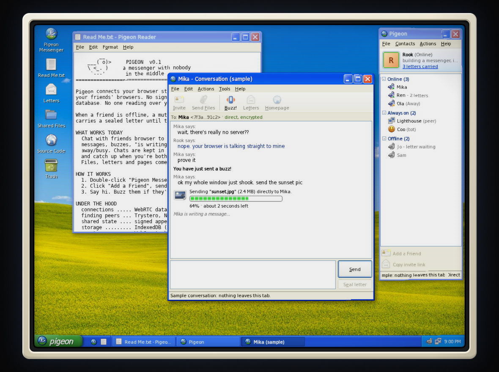

<div align="center">
    
    <h1>Pigeon</h1>
    <p>
        A messenger with nobody in the middle, inside an early-2000s desktop that never was.
    </p>
    <p>
        <a href="https://github.com/tomszir/pigeon/actions/workflows/ci.yml"></a>
        <a href="https://github.com/tomszir/pigeon/releases/latest"></a>
        <a href="LICENSE"></a>
    </p>
</div>

<p align="center">
    
</p>

> [!NOTE]
> Pigeon is in early development. Chatting with friends, on all your devices, works today, even when they're offline. Files, groups and pages hosted by friends come later.
> Try it at **[pigeon.tomszir.com](https://pigeon.tomszir.com)**.

> [!WARNING]
> Pigeon's own protocol hasn't been independently audited. Don't use it where your safety depends on it. To report a problem, see [SECURITY.md](SECURITY.md).

## What it does

It's 2003, peer-to-peer won and the cloud never happened. Pigeon is the messenger from that world: your browser talks straight to your friends' browsers, with no account, no server keeping your chats and no one reading over your shoulder.

- **Add friends with a link or a code:** send an invite link that waits up to 30 days, for one friend or several, and approve each one who asks; or show a quick code to someone next to you. Pigeon checks it's really them by their fingerprint.
- **Messages that wait:** chat browser to browser, buzz, see who's writing. Write to a friend who's offline and it's left, sealed, at their Lighthouses until they're back, and each message says where it is.
- **All your devices:** link your phone to your laptop and it's you there too, with your friends, your name and your chats. A recovery key brings your Pigeon back if you lose them.
- **A whole desktop:** windows, a taskbar, a CRT monitor and Pigeon Explorer for `pigeon://` pages; on a phone, the Kestrel Pocket, a 2003 handheld with a home screen and soft keys.

<table>
    <tr>
        <td width="50%"></td>
        <td width="50%"></td>
    </tr>
    <tr>
        <td></td>
        <td></td>
    </tr>
</table>

## Try it

Open [pigeon.tomszir.com](https://pigeon.tomszir.com), choose a name, and send a friend an invite link from Add a Friend. Or try it alone in two browsers.

## How it works

Browsers connect directly over WebRTC. To find each other, they post small signed notes on public Nostr relays through [Trystero](https://github.com/dmotz/trystero), and the relays only ever see that two strangers want to meet. Everything after that, messages included, goes browser to browser, encrypted.

Each browser makes its own identity, a WebCrypto key pair that never leaves it, and your fingerprint comes from it. Every message is signed, so a friend can't be impersonated, and each chat is a signed append-only log that two browsers merge when they meet. Friends meet in a room named and locked by a secret only the two of them hold, renamed every day, so knowing two people's ids says nothing about when they talk. Several devices are one person through a device log your first device signs. The protocol is in [docs/protocol.md](docs/protocol.md).

Honest P2P has a cost: a friend has to be online for a message to arrive. Lighthouses get around it: peers anyone can run that hold mail sealed to a friend's devices until they're back, without being able to open it or say whom it's from. Messages, invite links, farewells and your own devices' changes all go through them. Pigeon uses the three official Lighthouses (Loft, Dovecote and Perch) unless you add your own in Network. [docs/lighthouse.md](docs/lighthouse.md) says how to run one, and what it stores and sees.

## Privacy

Pigeon keeps nothing on a server. The site is static files on Cloudflare, chats and keys stay in your browser's IndexedDB, and there is no analytics. The public relays see that a connection was arranged, not what was said. When two devices can't reach each other directly, as a phone on mobile data often can't, Cloudflare's TURN relay passes the encrypted packets along without being able to read them; Always Go Through the Relay uses it for everything, so friends never see your IP address. Clearing the site's data deletes your identity and chats for good.

A Lighthouse stores only sealed mail it can't open, under tags that change daily and can't be traced to you, for 30 days at most, and nothing about who put or fetched it. While it runs it does see your IP address, when you connect, and which tags you ask for, so watching live it can tell which addresses exchange mail, though not who they are. Every reply it sends is signed, and checked against its key.

## Browser support

Pigeon is tested in Chromium on the desktop and on emulated phones. It needs WebRTC, IndexedDB and WebCrypto, which every current browser has. Each device signs with an Ed25519 key, so a browser too old for Ed25519 in WebCrypto (before Chrome and Edge 137, Firefox 129 and Safari 17) can't make a new identity; P-256 identities made by earlier Pigeons keep working.

## Development

```sh
mise install && mise run setup   # tools, dependencies and git hooks
mise run dev                     # the web app on Vite's dev server
mise run check                   # lint, types, unit tests and docs
```

Start with [docs/README.md](docs/README.md), then see [CONTRIBUTING.md](CONTRIBUTING.md) for commits, how docs and comments are written, and how releases work.

## Credits

- Control styling values and title-bar bitmaps from [XP.css](https://github.com/botoxparty/XP.css) (MIT).
- Tahoma clone from the [Wine project](https://www.winehq.org/) (LGPL 2.1).
- Bitstream Vera Sans Mono from [Bitstream](https://download.gnome.org/sources/ttf-bitstream-vera/) (Bitstream Vera licence).
- Wallpaper photo by [@bchen22](https://unsplash.com/@bchen22) on [Unsplash](https://unsplash.com/) ([Unsplash License](https://unsplash.com/license)).
- Icons from the [Tango Desktop Project](http://tango.freedesktop.org/) (public domain).

Not affiliated with or endorsed by Microsoft.

## License

The code is [MIT](LICENSE). The vendored fonts, icons, styling values and wallpaper above keep their own licences.
