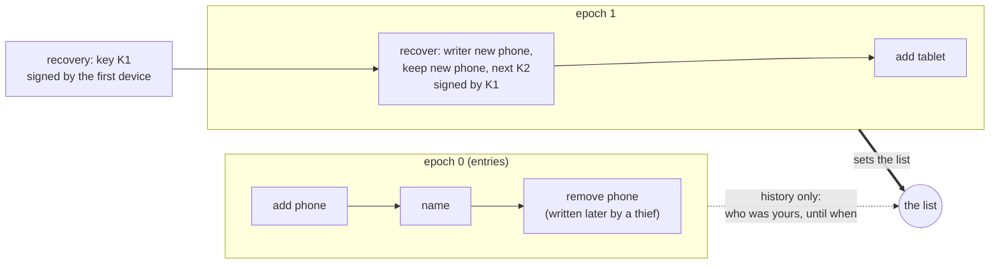
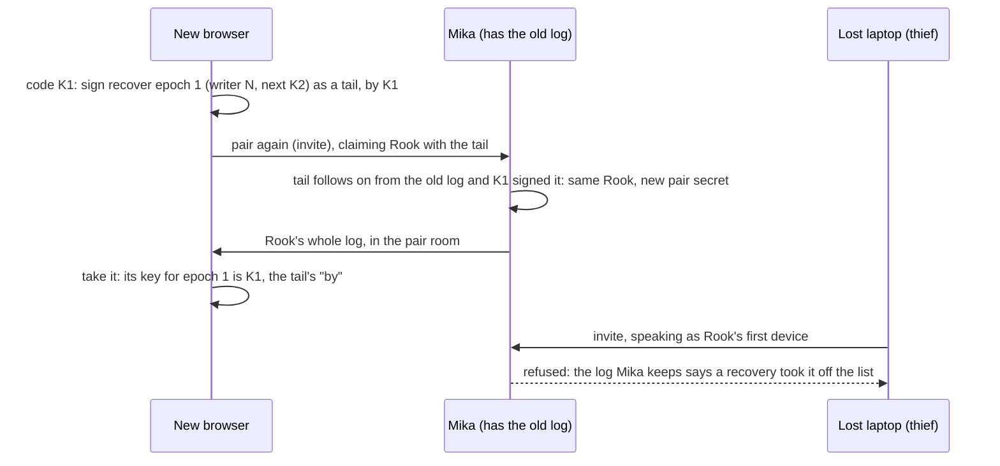

# 0030: The recovery key beside the chain

How 0027's recovery key is built: Ed25519 only, kept in fields beside the device log's chain that older Pigeons ignore, offered right after a new Pigeon gets its name, and completed by friends after a recovery.

- Status: accepted
- Date: 2026-11-25

## Context

[0027](0027-a-recovery-key-that-outranks-devices.md) decided what a recovery key does. Building it raised four questions it left open. A Pigeon from 0.5 rejects any device-log entry kind it doesn't know, so putting the key in the chain would cut off your linked devices for every friend who hasn't updated. WebCrypto can't rebuild a P-256 key from its private scalar alone, so a P-256 key can't come back from a code. A device brought back with nothing has no copy of the epochs before its own. And a key nobody is asked to make is a key nobody has.

## Decision

- **Ed25519 only.** A browser without Ed25519 can't make a recovery key, and says so. The code holds the key's 32-byte seed, the identity's public key, the epoch, a version and a 2-byte SHA-256 checksum, in base32 groups of four (28 groups for an Ed25519 identity).
- **Beside the chain.** The device log's `entries` stay epoch 0's, signed exactly as before. The first device's commitment to a key is `recovery` (`{ key, at, sig }`), and each recovery is an item of `epochs` (`{ recover, entries }`). A Pigeon from before ignores both. Until you recover, nothing changes for it; after, it keeps trusting your old devices until it updates. Committing a key also signs a `name` entry renaming the first device to its own name: a Pigeon from before takes a log only when it has more entries, and then keeps the object whole, so it keeps the commitment for when it updates.
- **Each epoch stands on its own.** A recover doesn't say where the epoch before it ended, since a device recovering with nothing doesn't know. So an epoch holds or fails on its recover's signature and its own chain alone, and the list comes from the latest epoch only. Older epochs' entries only say who was once yours and until when. A stolen first device writing more of epoch 0 after a recovery changes nothing and can't make a log fail anywhere.
- **Tails, completed by friends.** A recovered device's log holds only its own epoch, with `from` set and `by`, the key it signed with. A tail can't be checked alone, since nothing in it shows the key was yours, so only someone who already has your earlier epochs takes it: a friend you pair with again. They then send your whole log back to you in your pair room, and you take it only if its key for your epoch is `by`. A stranger refuses a tail, so a forged key can't pose as you to people who never knew you.
- **What you already know wins.** Pairing checks whoever answers against the log you keep for them, loaded from storage if need be. An old copy can't undo a recovery you've seen, and a device a recovery took off its own list (a stolen first device, which speaks for itself) is turned away. Where two copies name different recovery keys, the first you had stays.
- **One limit for the whole log.** 100 entries across all epochs, up to 8 epochs, and up to 8 kept devices per recover, so a log fits one envelope. When a merge would hold more, the oldest epochs lose their last entries, which is where a thief's late entries would be. The current epoch is never cut.
- **Offered after the name.** Right after a new Pigeon gets its name, Make a Recovery Key opens. "Later" is allowed, a balloon reminds you once on a later visit, and the File menu offers it until you have one. The list commits to a key only after you say you've kept it, since a key committed but not kept can never be replaced.
- **The next key first.** Using a key (Recover My Pigeon on an empty Pigeon, Use My Recovery Key on a device that's already you) shows the next key, and signs the `recover` only once you say you've kept that one.

## Diagrams

What a log holds, and which part decides the list. Each epoch is checked on its own; only the latest sets who is on the list.

A recovery with every device lost. The tail can't be checked on its own, so the first friend who knew you checks it against your old log and hands the whole log back.

## Consequences

A thief who still has the first device can go on making friends with people who never knew you, as 0024 already allows. Worse, at a friend still on 0.5 when your first device is stolen, the thief can sign one more epoch-0 entry with your recovery key left out, or swapped for one of their own, and that friend keeps it whole. Once they update, they refuse your real recovery, and in the swapped case they take the thief's. Nothing in the protocol can tell the two commitments apart, since both carry the first device's signature. The guard is that friends who have updated keep the first commitment they saw. A recovered device can't link another device until an old friend has handed back its whole list, since the new device couldn't check a tail either. Until then the tail is the only copy of the recovery, so that device refuses to be linked or recovered over, except with the same code again. The next key is worth nothing until a friend has seen the recovery, so the old code still matters until then, and the windows say so. Lose that device before any friend has paired with it again, and the old code starts over. Friends on 0.5 keep working until you recover. After that they must update before they hear your recovered device, and until then they still trust your lost ones. A recovered device can't make new friends until an old friend has handed back its whole log. Browsers without Ed25519 (Safari before 17) can't make a key at all. Epoch 0's entry bytes didn't change, so no existing log needs migrating, and later epochs' entries sign the epoch number too, so one can't be replayed into another.
